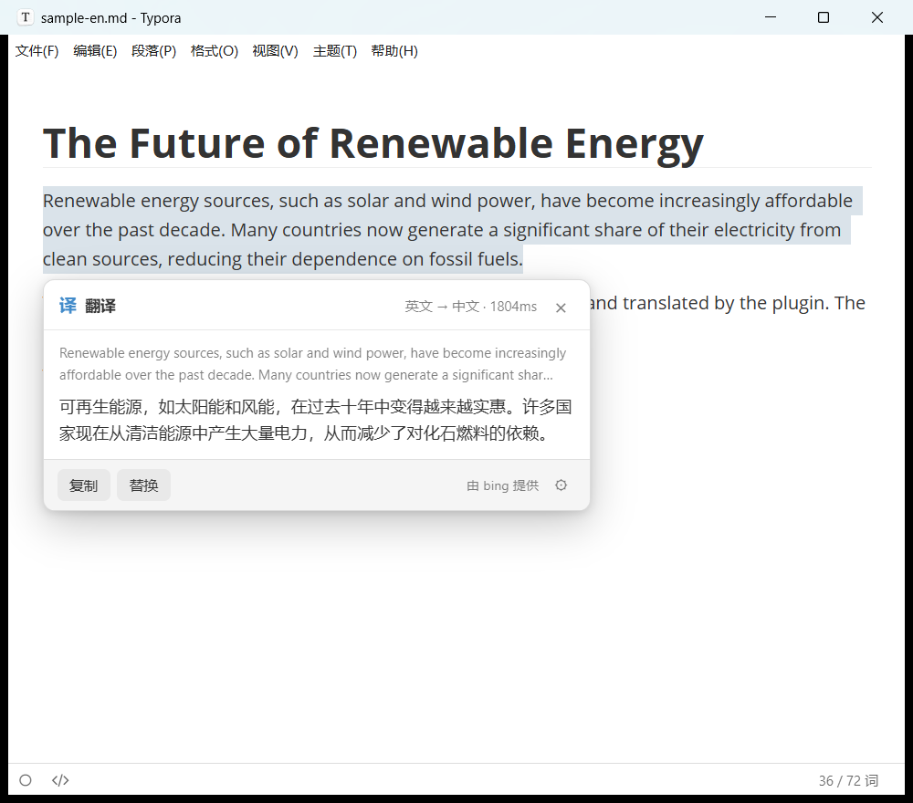

# Typora Translate（Typora 右键翻译插件）

选中一段英文 → 右键 → **翻译成中文**，译文以悬浮卡片显示，可复制或直接替换原文；单字选中时自动查词典（音标 + 释义）。也支持快捷键 `Ctrl+Shift+T`。

> 适用：Typora 1.x（Windows），已在 **Typora 1.12.4 / Electron 35** 上验证通过。
> 无需 API Key，默认使用 Bing 翻译（国内可直连），失败时自动回退 MyMemory。

> **English** — A Typora (1.x, Windows) plugin that adds "select text → right-click → Translate" plus a `Ctrl+Shift+T` hotkey, with a floating result panel (copy / replace / retry) and dictionary lookup for single words. No API key required by default (Bing web translator, MyMemory fallback). MIT licensed.



---

## 一、功能

| 功能 | 说明 |
| --- | --- |
| 右键翻译 | 选中文本后右键，菜单中出现「翻译成中文 / 翻译成英文」 |
| 快捷键 | `Ctrl+Shift+T`：有选区时翻译选区；无选区时翻译光标所在段落/当前行 |
| 悬浮译文卡片 | 显示译文与方向、翻译服务、耗时；支持复制、替换选中文本、重试、打开设置 |
| 单词词典 | 选中单个英文单词时，优先显示音标 + 词性 + 中文释义（有道词典），查不到自动回退机器翻译 |
| 中英双向 | 英文 → 中文；中文 → 英文（自动判断方向，也可在配置中固定） |
| 主题适配 | 跟随 Typora 当前主题的明暗/配色（浅色、深色主题均可读） |
| 完全本地运行 | 插件逻辑在 Typora 内运行，选中文本只发送给你选择的翻译服务，不经过任何中间服务器 |
| 可配置 | 翻译服务顺序、目标语言、快捷键、面板宽度、是否查词典、可选 LLM（如 DeepSeek） |

界面语言跟随系统（中文系统显示中文，否则英文），也可在配置中固定。

---

## 二、安装

### 前置要求

- Windows 10/11
- Typora 1.x（本插件通过修改 `window.html` 注入，Typora 升级后需重装）
- PowerShell 5.1 或 PowerShell 7

### 从 GitHub 获取

```powershell
git clone https://github.com/jasonyu8999/typora-translate.git
cd typora-translate
```

### 一键安装

在仓库目录（`typora-translate`）打开 PowerShell，执行：

```powershell
powershell -NoProfile -ExecutionPolicy Bypass -File .\install.ps1
```

> 本机若只有 Windows PowerShell 5.1（Windows 自带），请用上面的 `powershell` 命令；
> 已安装 PowerShell 7 时也可把 `powershell` 换成 `pwsh`，并去掉 `-ExecutionPolicy Bypass`。

安装脚本会：

1. 自动查找 Typora 安装目录（注册表 / 运行中的进程 / 常见路径；也可用 `-TyporaPath` 指定）；
2. 把插件复制到 `<Typora>\resources\plugin\typora-translate\`；
3. 在 `<Typora>\resources\window.html` 中注入一行加载脚本（**会先备份**为 `window.html.typora-translate.bak`）；
4. 首次安装时在 `%APPDATA%\Typora\typora-translate\config.json` 生成默认配置。

完成后**完全退出 Typora（包括托盘图标）再重新打开**即可使用。

指定安装路径：

```powershell
powershell -NoProfile -ExecutionPolicy Bypass -File .\install.ps1 -TyporaPath "D:\Tools\Typora"
```

检查安装状态：

```powershell
powershell -NoProfile -ExecutionPolicy Bypass -File .\install.ps1 -VerifyOnly
```

> 如果 Typora 装在 `Program Files` 等受保护目录，请用**管理员身份**运行 PowerShell。

### 手动安装（不想用脚本时）

1. 把 `src\plugin\` 下全部文件复制到 `<Typora>\resources\plugin\typora-translate\`；
2. 用文本编辑器打开 `<Typora>\resources\window.html`，在结尾 `</body>` 前加入：

```html
<!-- typora-translate:start -->
<script src="./plugin/typora-translate/bootstrap.js" id="typora-translate-bootstrap"></script>
<!-- typora-translate:end -->
```

3. 重启 Typora。

---

## 三、使用

1. 选中一段英文文本；
2. 右键 → 点击「**翻译成中文**」；
3. 译文卡片出现在选区下方：
   - **复制**：把译文复制到剪贴板；
   - **替换**：用译文替换选中的原文（可在 Typora 中撤销）；
   - **重试**：翻译失败时重试；
   - **⚙**：打开配置文件。
4. 选中中文文本时，菜单显示「翻译成英文」。

快捷键 `Ctrl+Shift+T` 效果相同；不选中文本时翻译光标所在段落（源码模式下为当前行）。

关闭卡片：点击 ×、按 `Esc`、或点击卡片以外区域。

---

## 四、配置

配置文件：`%APPDATA%\Typora\typora-translate\config.json`
（首次安装自动生成；修改后**无需重启**，下次翻译即生效；点击卡片上的 ⚙ 可直接打开）

```json
{
  "enabled": true,
  "providers": ["bing", "mymemory"],
  "targetLang": "auto",
  "shortcut": "Ctrl+Shift+T",
  "panelWidth": 480,
  "lookupWords": true,
  "maxChars": 20000,
  "language": "auto",
  "llm": {
    "enabled": false,
    "baseUrl": "https://api.deepseek.com/v1",
    "apiKey": "",
    "model": "deepseek-chat"
  }
}
```

| 字段 | 说明 |
| --- | --- |
| `enabled` | `false` 可临时停用插件（不改文件，重启后也不加载） |
| `providers` | 翻译服务及优先级：`bing`（默认）、`mymemory`、`llm` |
| `targetLang` | `auto`（自动：英→中、中→英）、`zh-Hans`（总是译成中文）、`en`（总是译成英文） |
| `shortcut` | 快捷键，如 `Ctrl+Shift+T`、`Alt+T` |
| `panelWidth` | 译文卡片宽度（像素），默认 480 |
| `lookupWords` | 选单词时是否查词典，默认 `true` |
| `maxChars` | 单次翻译的最大字符数（超出会按句子边界截断） |
| `language` | 界面语言：`auto` / `zh` / `en` |
| `llm` | 可选：使用 OpenAI 兼容接口的 LLM 翻译（质量更好，需自备 Key）。配置 `providers` 中加入 `"llm"` 并在 `llm.enabled` 为 `true`、填入 `apiKey` 后生效，例如 DeepSeek：`baseUrl: "https://api.deepseek.com/v1"`、`model: "deepseek-chat"` |

---

## 五、卸载

```powershell
powershell -NoProfile -ExecutionPolicy Bypass -File .\uninstall.ps1
```

脚本会从备份恢复 `window.html`（无备份时仅移除注入块）、删除插件目录；配置和日志默认保留。
如需一并删除配置与日志：

```powershell
powershell -NoProfile -ExecutionPolicy Bypass -File .\uninstall.ps1 -PurgeConfig
```

---

## 六、Typora 升级后

Typora 升级会覆盖 `window.html`，插件会暂时失效（右键菜单没有「翻译」项）。
**升级后重新运行一次 `install.ps1` 即可**，配置保留。

---

## 七、常见问题

**Q1：右键菜单里没有「翻译」项？**

- 确认已完全退出（含托盘）并重启 Typora；
- 运行 `install.ps1 -VerifyOnly` 检查注入状态，必要时重新 `install.ps1`；
- 看日志：`%APPDATA%\Typora\typora-translate\plugin.log`，正常应包含 `[BOOT] ready` 与 `[MENU] inserted rich=true source=true`。

**Q2：提示翻译失败？**

- 默认服务为 Bing 翻译，需要能访问 `cn.bing.com`；失败会自动回退 MyMemory；
- 网络受限时可配置 `llm`（DeepSeek 等）作为翻译服务；
- 详细错误见 `plugin.log` 中的 `[TRANSLATE]` / `[ERROR]` 行。

**Q3：安装脚本报权限错误？**

Typora 位于受保护目录时需要管理员 PowerShell；或安装到其他盘（如 `D:\Tools\Typora`）。

**Q4：替换功能会把格式弄乱吗？**

「替换」对普通段落是安全的，可 `Ctrl+Z` 撤销；代码块、表格等复杂结构中建议只用「复制」。

**Q5：会不会影响 Typora 稳定性 / 有安全风险？**

插件加载失败时只会在日志里记录错误，不影响 Typora 本体。它没有外部依赖、不监听端口、不自动上传除「选中的待翻译文本」以外的任何内容（文本只发往你在配置中选择的翻译服务）。

---

## 八、隐私说明

- 翻译时，**仅你选中的文本**会发送给翻译服务提供方（默认 Bing / MyMemory；或你配置的 LLM）；
- 配置、日志、状态文件只保存在本机 `%APPDATA%\Typora\typora-translate\`；
- `plugin.log` 只记录元数据（文本长度、翻译服务、耗时、错误），不记录正文；
- `status.json` 为便于排查问题会保留**最近一次**翻译的原文/译文预览（原文 ≤ 500 字符、译文 ≤ 2000 字符）；如不希望保留，可删除该文件，或用 `uninstall.ps1 -PurgeConfig` 一并清理。

---

## 九、实现原理（供开发者参考）

Typora 没有插件 API，本插件采用与社区插件相同的「资源注入」方式：

1. `install.ps1` 在 `resources/window.html` 末尾注入 `<script src="./plugin/typora-translate/bootstrap.js">`；
2. `bootstrap.js` 依次加载 `styles.css`、`service.js`（翻译引擎）、`ui.js`（Typora 集成）；
3. Typora 的右键菜单本身是 DOM（`<ul class="menu" id="context-menu">` 内的 `<li data-key>`），插件向其中插入「翻译」菜单项，并在 `contextmenu` 捕获阶段记录选区；
4. Typora 渲染进程未暴露 `require`，但提供了 `window.reqnode(name)`，插件借此获得 Node 的 `https/fs/path/electron`，于是翻译请求不受 CORS 限制、可直接调用系统剪贴板；
5. 翻译引擎（`service.js`）是纯 JS UMD 模块，同一份代码既能在 Typora 内运行，也能在 Node CLI 下测试。

```
typora-translate/
├─ install.ps1 / uninstall.ps1     安装/卸载脚本
├─ config/config.example.json      默认配置
├─ src/plugin/
│  ├─ bootstrap.js                 加载器（注入入口）
│  ├─ ui.js                        右键菜单、选区、悬浮卡片、快捷键、配置、日志
│  ├─ service.js                   翻译引擎（Bing / MyMemory / 有道词典 / 可选 LLM）
│  └─ styles.css                   主题适配样式
├─ tests/                          翻译引擎测试 + 测试用 Markdown
├─ tools/                          端到端验证工具（非运行时）
│  ├─ e2e.ps1 / win-ui.ps1         冷启动 Typora、Win32 UI 操作、断言 + 截图
│  └─ e2e-readme.md                E2E 用法、通过标准与已知问题
└─ docs/screenshots/               验证截图
```

运行翻译引擎测试：

```powershell
node .\tests\service.test.js
```

（无 Node 环境时可跳过；这是开发用测试，不影响插件使用。）

---

## 十、验证（可复现）

本项目包含两层自动化验证，均已在本机（Typora 1.12.4 / Windows 10 / 125% 缩放）实际运行通过：

1. **翻译引擎测试**（真实网络，52 项断言）：中英双向、长文分块、有道词典、缓存、失败回退、Typora 渲染器沙箱（`window.reqnode`）路径等。

   ```powershell
   node .\tests\service.test.js
   ```

   （Node 未加入 PATH 时，把 `node` 换成 `node.exe` 的完整路径即可。）

2. **Typora 端到端测试**（冷启动 Typora → 选中文本 → 右键 / `Ctrl+Shift+T` → 校验状态、日志与截图）：

   ```powershell
   powershell -NoProfile -ExecutionPolicy Bypass -File .\tools\e2e.ps1 -Phase all
   ```

   最近一次结果：**PASS 3/3，14.3 秒，退出码 0**（boot / hotkey / contextmenu 全部通过；截图见 `docs/screenshots/`）。

> 说明：E2E 依赖真实桌面会话（Windows UI 自动化），需要 Typora 未运行且桌面可交互；它只结束自己启动的 Typora 进程，不会影响你正在编辑的文档。

---

## 十一、免责声明与许可

- 本项目为个人开源项目，与 Typora 官方无关；插件通过修改本地 `window.html` 注入代码，属于非官方扩展方式，Typora 升级后需重新安装。
- 默认使用 Bing 网页翻译 / MyMemory 的公开接口（非官方 API），可能受服务商限流、改版或地区限制；高频、批量或商业用途请改用官方翻译 API，或在配置中接入自有 LLM。
- 仅当你选中文本并触发翻译时，所选文本才会发送给对应的翻译服务；其余数据均留在本机。
- 本项目采用 **MIT** 许可证，详见 [LICENSE](LICENSE)。

---

## 十二、版本

**1.0.0** — 首个版本：右键翻译、快捷键、悬浮译文卡片（复制/替换/重试/设置）、单词词典、中英双向、主题适配、Bing + MyMemory 双服务、可选 LLM。